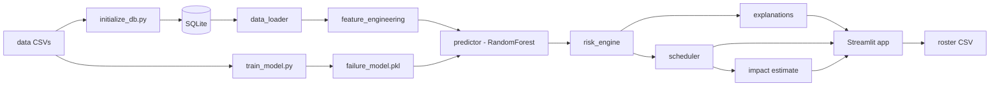

# 🚇 MetroGuard — Fix It Before It Breaks

**Predictive maintenance & night-shift planning for metro ticket gates, vending machines, lifts and escalators.**
Metro Hacks · PS-02 · runs 100% offline · one command to start.

> ⚠️ **Synthetic data.** This prototype uses synthetic data because the hackathon does not provide operational metro datasets. Station names are Ahmedabad/Gujarat-style labels for demonstration only. **Nothing here is real Gujarat Metro data**, and every rupee figure below is an *illustrative assumption*, not a measured result.

---

## The 30-second pitch

> Metro maintenance is reactive today: an escalator stops, a lift jams, a gate row goes dark, *then* someone is sent.
>
> MetroGuard reads historical fault logs, estimates which assets have the highest **predicted failure risk in the next 7 days**, and turns that into an **explainable, prioritised night-shift roster** — who goes where, in which time slot, and what to inspect first.
>
> The whole core workflow runs locally and keeps working with Wi-Fi off.

```
Fault logs ──► Features ──► Random Forest ──► Hybrid risk 0–100 ──► Reasons ──► Night roster ──► CSV
                (16)         7-day failure      70/10/10/10         plain         3 teams,        for
                             probability                            English       22:00–05:00     technicians
```

---

## Headline numbers

Measured by running the code in this repo on the bundled synthetic data (reproduce with `python scripts/train_model.py` and `python scripts/check_predictions.py`).

| | |
|---|---|
| Assets monitored | **900** (200 escalators · 150 lifts · 400 ticket gates · 150 ticket machines) |
| History | **26,601** fault records · **17,024** maintenance records · 2 years |
| Failure-ranking skill (held-out weeks) | **Top-29 picks hit a real failure 64% of the time vs 12% for random — 5.2× better than chance** |
| ROC-AUC (time-held-out) | 0.71 |
| Fleet risk spread | 4 CRITICAL · 9 HIGH · 28 MEDIUM · 177 LOW · 682 NORMAL |
| Tonight's roster | **29 jobs** across Teams A/B/C at 88–90% utilisation; 11 more deferred to next shift |
| Demo assets (scored by the model, not hardcoded) | **LIFT-027 #1 · AFC-381 #2 · ESC-104 #3** — all CRITICAL |

Why it matters: a random walk-round finds a problem asset about 1 time in 8. Following the MetroGuard roster, about 2 in 3 inspections land on an asset that really did fail that week.

---

## 💰 How much could it save?

The app shows an **Estimated impact** panel under the roster. For tonight's default roster:

| Per roster (29 jobs) | Value |
|---|---|
| Failures avoided (expected) | ≈ **9** |
| Downtime avoided | ≈ **9 hours** |
| Planned crew cost | ₹37,500 |
| **Estimated net saving** | **≈ ₹3.3 lakh** (≈ 8.7× the crew cost) |

**Sensitivity — the number depends on how often a planned visit really prevents the failure:**

| Prevention share | Failures avoided | Net saving per roster | If run weekly (×52) |
|---|---|---|---|
| 30% (cautious) | 5.4 | ≈ ₹1.8 lakh | ≈ ₹94 lakh / yr |
| **50% (default)** | **9.0** | **≈ ₹3.3 lakh** | **≈ ₹1.7 crore / yr** |
| 70% (optimistic) | 12.6 | ≈ ₹4.7 lakh | ≈ ₹2.5 crore / yr |

**How it's calculated** (`src/impact.py`):

```
failures avoided = Σ  ML probability × prevention share
avoided cost     = failures avoided × assumed cost of one unplanned failure (by asset type)
planned cost     = job minutes ÷ 60 × crew rate
net saving       = avoided cost − planned cost
```

**Assumptions (all editable in the app, all invented for demonstration):**

| Asset type | Assumed cost of one unplanned failure |
|---|---|
| Lift | ₹80,000 |
| Escalator | ₹60,000 |
| Ticket gate | ₹25,000 |
| Ticket machine | ₹20,000 |

Crew rate ₹2,000/hour · prevention share 50% · the weekly annualisation assumes one roster of similar size per week.

**Be honest with judges:** these costs are placeholders. The value of the prototype is the *method* — swap in the operator's real emergency-repair, passenger-delay and revenue-loss figures and the same panel gives a real business case.

---

## 🎬 3-minute demo script

1. **Dashboard** — five KPI cards, risk distribution, top-10 table, station risk. Point at the *Demo spotlight*: ESC-104, LIFT-027, AFC-381.
2. **Asset Risk → LIFT-027** — score 100/100 CRITICAL, 7-day failure probability, plain-English reasons (10 faults in 7 days, rising fault frequency, 50 days overdue, high downtime), recent faults, maintenance history, recommended action, passenger impact.
3. **Maintenance Roster** — click **Generate Roster**. Show time slots, team assignments, deferred list, then **Download CSV**.
4. **Estimated impact** — open *Assumptions*, drag the prevention share, watch the saving change.
5. **Turn Wi-Fi off, refresh** — everything still works.

Closing line: *"Prediction alone isn't enough. MetroGuard tells technicians what to inspect first."*

---

## What's in the app

| Page | What you get |
|---|---|
| **Dashboard** | Assets monitored, High/Critical counts, predicted failures, maintenance overdue; risk distribution; risk by asset type; top 10; station-wise risk |
| **Asset Risk** | Filters (station, type, category, criticality) + search; click a row for score, ML probability, reasons, recent faults, maintenance history, recommended action, operational impact |
| **Maintenance Roster** | Night-shift plan with date, window, teams; Generate Roster; team utilisation; deferred jobs; CSV download; print-friendly view; **estimated impact** |
| **Analytics** | Faults by type and station, monthly trend, average downtime, overdue distribution, high-risk by station |
| **Data** | Browse the synthetic assets, fault logs and maintenance logs |
| **About** | Method, validation metrics, feature importances, safety wording |

Every page shows **● LOCAL / OFFLINE** — meaning the prediction engine runs on this machine. It does *not* test connectivity.

---

## 🔍 Explainable by design

No black box on the shop floor. Every asset gets deterministic, template-based reasons using its own numbers (no LLM):

```
LIFT-027 has predicted failure risk 100/100 (CRITICAL) because:
• 10 faults occurred in the last 7 days
• 14 faults occurred in the last 30 days
• Fault frequency is increasing (+14 vs the previous 15 days)
• Maintenance is 50 days overdue
• High recent downtime: 1121 min in the last 30 days
• Recent downtime is increasing
Recommended: Inspect door mechanism and door sensors.
Prototype recommendation — technician validation required.
```

The final score is a hybrid, not the raw model output:

`risk = 100 × (0.70·ML + 0.10·criticality + 0.10·fault trend + 0.10·maintenance overdue)`

| Score | Category |
|---|---|
| 90–100 | CRITICAL |
| 75–89 | HIGH |
| 50–74 | MEDIUM |
| 25–49 | LOW |
| 0–24 | NORMAL |

---

## 🚀 Quick start — one click

Needs **Python 3.11+** installed. Nothing else.

| Your system | Do this |
|---|---|
| **Windows** | Double-click **`run.bat`** |
| **macOS / Linux** | Run `bash run.sh` |

The launcher creates a private `.venv`, installs the packages (the **only** step that needs internet, first run only), checks the bundled data, database and model (rebuilding them locally only if missing), and opens **http://localhost:8501**. Every later launch skips setup and starts in seconds. Close the window (or press Ctrl+C) to stop.

Manual alternative:

```bash
python -m venv .venv
.venv\Scripts\activate           # macOS/Linux: source .venv/bin/activate
pip install -r requirements.txt
python -m streamlit run app.py
```

To rebuild data and model from scratch:

```bash
python scripts/generate_data.py   # deterministic synthetic data (seed 42)
python scripts/initialize_db.py   # SQLite from the CSVs
python scripts/train_model.py     # train + save model/failure_model.pkl
```

Developer checks: `check_predictions.py` (score spread + demo assets), `smoke_test_app.py` (every page, headless), `test_error_paths.py` (missing model/CSV/DB), `verify_offline.py` (blocks non-loopback sockets, runs the whole app).

---

## 🏗️ Architecture



| Module | Responsibility |
|---|---|
| `src/config.py` | Every constant: paths, weights, bands, roster defaults, cost assumptions |
| `src/data_loader.py` | SQLite first, CSV fallback; validates columns; friendly errors |
| `src/feature_engineering.py` | Leakage-free features and the weekly training frame |
| `src/model.py` | Build / evaluate / save / load the RandomForest bundle |
| `src/predictor.py` | Features → probability → risk → explanations |
| `src/risk_engine.py` | Hybrid 0–100 score, category, priority |
| `src/explanations.py` | Reasons, recommended action, operational impact |
| `src/scheduler.py` | Greedy night-shift roster |
| `src/impact.py` | Assumption-based savings estimate |
| `app.py` | Streamlit UI, cached data / model / predictions |

**Stack:** Python 3.11+, Streamlit, pandas, numpy, scikit-learn, joblib, SQLite, Plotly. No cloud, no external DB, no LLM, no network calls.

---

## 🧠 ML methodology

* **Target:** a fault of severity ≥ 3 in the next 7 days.
* **No future leakage:** one snapshot per asset per week; features use only records strictly *before* the snapshot, the label only the 7 days after.
* **Model:** `RandomForestClassifier` (300 trees, `min_samples_leaf=10`, `max_depth=12`, seed 42). Not class-weighted, so probabilities stay near the true base rate (≈12%).
* **Validation:** time-based — the last 120 days are held out, with a 7-day gap so labels never overlap training. ROC-AUC 0.71, average precision 0.37 (base rate 0.12). At the 0.35 threshold: precision 0.58, recall 0.21.
* **Ranking skill:** each held-out week, the 29 highest-scored assets contained a real failure 64% of the time (5.2× the 12% base rate). The model is a *ranking* tool for deciding where to send limited crews, not a crystal ball.
* The final model is refit on all history and saved with feature list, imputation medians, metrics and importances.

### Features

| Feature | Meaning |
|---|---|
| `asset_age_years` | Years since installation |
| `fault_count_7d / 30d / 90d` | Faults in the trailing window |
| `average_downtime_30d`, `total_downtime_30d` | Downtime minutes (mean per fault / sum) |
| `max_severity_30d` | Worst severity (1–5) |
| `average_repair_time_30d` | Mean repair minutes |
| `days_since_last_fault`, `days_since_last_maintenance` | Recency, capped at 400 if never |
| `maintenance_overdue_days` | max(0, days since service − planned interval) |
| `previous_failure_count` | Severity ≥ 3 faults in the last 365 days |
| `fault_frequency_trend` | Faults in the last 15 days minus the 15 days before |
| `downtime_trend` | Same, for downtime minutes |
| `criticality`, `maintenance_interval_days` | From the asset register |
| `type_*` | One-hot asset type |

Missing values: counts and sums → 0, "never" → capped sentinel, median imputation at inference.

---

## 🗓️ Scheduling

`src/scheduler.py` — deliberately simple, greedy and explainable:

1. Take assets above a risk threshold (default 50), ordered by risk → criticality → overdue days → severity → downtime; cap the job count.
2. Give each job to the team that becomes free earliest (Team A/B/C), using the asset's estimated maintenance minutes plus a 5-minute transfer buffer.
3. Window defaults to 22:00–05:00 (overnight handled). Jobs that don't fit appear under **Deferred to next shift**.

Window, teams, threshold and job cap are editable on the page. Priority 1 = most urgent asset.

---

## 📡 Offline architecture

* **No external API is required** — the code contains no HTTP or socket calls; Streamlit usage statistics are disabled in `.streamlit/config.toml`.
* **The model is local** — `model/failure_model.pkl`, loaded once with `st.cache_resource`.
* **The database is local** — SQLite in `database/`, with the CSVs as fallback.
* **The data is local** — bundled and synthetic.
* **The core workflow works with Wi-Fi disabled** — loading, scoring, explanations, roster, charts, CSV export.
* `scripts/verify_offline.py` blocks every non-loopback socket and runs the full app: 0 outbound attempts.

---

## 🛣️ What else can the operator do with this? (roadmap)

**Near term — same architecture, real data**
* Plug in real fault logs and work orders from the **CMMS / maintenance management system** and retrain with one command.
* Replace the assumed costs with the operator's actual emergency-repair, passenger-delay and revenue-loss figures to get a defensible business case.
* Calibrate thresholds per asset type; track predicted-vs-actual each week to prove accuracy.

**Medium term — more signal, closer to technicians**
* Ingest **SCADA** and **asset telemetry** (motor current, vibration, temperature, door cycles) for earlier warnings than fault logs alone.
* Push rosters to **technician mobile devices** and capture completion notes, closing the feedback loop for retraining.
* Link to **station control systems** to weigh passenger load and time-of-day impact.
* Constraint-aware scheduling: technician skills, spare parts, travel time between stations, track-access windows.

**Longer term — from predicting to optimising**
* Time-to-failure (survival) models and remaining-useful-life estimates.
* Spare-parts forecasting from predicted failures by type and station.
* Contract and warranty insights per manufacturer; replacement-versus-repair planning.
* Fleet-wide benchmarking across lines and depots.

*These are integration points and ideas only. None are implemented in this prototype.*

---

## ⚖️ Limitations — what we won't oversell

* **Synthetic data:** metrics show the pipeline works, not real-world accuracy. Real faults are messier.
* **Modest model:** ROC-AUC ≈ 0.71. It is useful for *ranking* where to look first; it will miss many failures (recall 21% at the default threshold).
* **Savings are assumption-based:** the rupee figures use invented costs and a 50% prevention share. Treat them as a template, not a forecast.
* **Simple scheduler:** greedy, ignores travel time, skills, spares and track access.
* **Recommended actions are templates** keyed to the dominant fault type — not official metro maintenance procedures.
* Hand-set risk weights; no authentication, write-back or live feeds.

## Safety note

MetroGuard is a decision-support prototype. It reports **predicted failure risk**, never certainty, and does not guarantee that any asset will or will not fail. Every action is a *Prototype recommendation — technician validation required.*

---

<sub>Built for Metro Hacks PS-02 · Synthetic data · Runs locally · Made with IBM Bob</sub>
